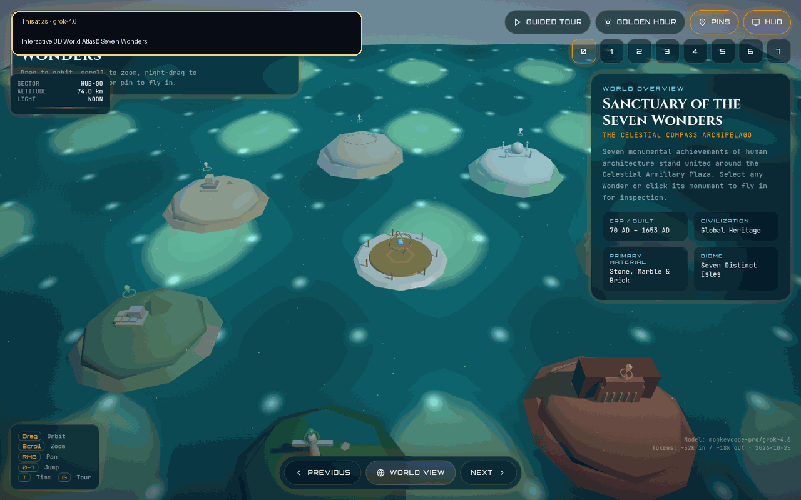

# Sanctuary of the Seven Wonders

Interactive 3D World Atlas — a single-file Three.js experience. Seven island biomes surround the Celestial Armillary Plaza. Click a monument or pin to fly in.

Open `index.html` in a modern browser, or serve the folder locally.

## Comparison

This atlas vs the Gemini 4 Argon reference:

Gemini 4 Argon reference: [https://gemini-4-argon.vercel.app/tests/gemini-4-argon-high-seven-wonders/index.html](https://gemini-4-argon.vercel.app/tests/gemini-4-argon-high-seven-wonders/index.html)

## Controls

- Drag to orbit, scroll to zoom, right-drag to pan
- Click a monument or pin to fly to it
- `0`–`7` jump · `T` golden hour · `G` guided tour · arrows previous/next

## Credits

- Model: monkeycode-pro/grok-4.6
- Tokens: ~52k in / ~18k out
- Date: 2026-10-25
